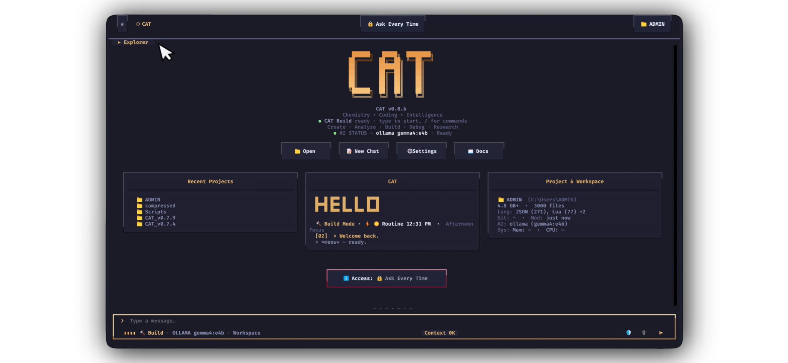

<div align="center">

<picture>
  <source media="(prefers-color-scheme: dark)" srcset="badge-mini.svg">
  <source media="(prefers-color-scheme: light)" srcset="badge-mini.svg">
  
</picture>
<hr>
<picture>
   <source media="(prefers-color-scheme: dark)" srcset="badge.svg">
  <source media="(prefers-color-scheme: light)" srcset="badge.svg">

</picture>

<!-- Tier 1 · Project health -->
[](https://pypi.org/project/cct-cli/0.8.0b1/)
[](https://github.com/kazizillani-oss/CAT_v0.7.9)
[](https://marketplace.visualstudio.com/items?itemName=KaziZillani.cat-cli)
[](https://github.com/kazizillani-oss/CAT_v0.7.9/actions/workflows/ci.yml)
[](LICENSE)
[](https://github.com/kazizillani-oss/CAT_v0.7.9/stargazers)
[](https://github.com/kazizillani-oss/CAT_v0.7.9/pulls)

<!-- Tier 2 · Runtime & compatibility -->


**Install your way:**

<!-- Tier 3 · Installation methods & open source -->
[](#option-5-quick-install-via-curl-method-5-linux-macos-windows)
[](#option-6-install-via-brew-for-macos--linux-method-6-homebrew)
[](#option-2-windows-installer-native-windows-experience)
[](#option-7-system-wide-linux-installation-via-sudo-method-7-linux-admin)
[](LICENSE)

*An autonomous AI developer terminal and chemical computation environment styled like OpenCode, Claude Code, and Warp in the Tokyo Night theme.*

</div>

---

## ⚡ Quick Install

CAT is free and open source (MIT) and is distributed across multiple channels. Choose the method that best fits your workflow — `curl`, `brew`, `irm`, `sudo`, PyPI, the Windows installer, or the VS Code extension:

> **⚠️ `pip install` failing with `SSL: CERTIFICATE_VERIFY_FAILED` / "unable to get local issuer certificate"?**
> That error is a **local machine or network certificate issue** (missing CA bundle on fresh macOS/Linux Pythons, or a corporate/school firewall re-signing HTTPS) — never a problem with the CAT package itself.
> One-line universal fix, then retry the install:
>
> ```bash
> python -m pip install --upgrade pip --trusted-host pypi.org --trusted-host files.pythonhosted.org
> ```
>
> Per-OS permanent fixes: **[🩺 SSL fix &amp; troubleshooting](#ssl-fix)** below.
> The CAT one-line installers (`install.sh` / `install.ps1`) detect and auto-repair this automatically.

<picture>

</picture>

### Option 1: Install from PyPI (Recommended for most users)

> **Status: Published & Live on PyPI!** 🚀  
> CAT CLI is officially published on PyPI: [**https://pypi.org/project/cct-cli/**](https://pypi.org/project/cct-cli/)

CAT CLI is distributed as [`cct-cli`](https://pypi.org/project/cct-cli/) on PyPI. The PyPI distribution name and the
terminal command are intentionally different:

```text
PyPI package: cct-cli  →  https://pypi.org/project/cct-cli/0.8.0b1/
CLI command:  cat      (plus aliases catx and cct)
```

**Install from PyPI:**

```powershell
# Install the official 0.8.0b1 release from PyPI:
pip install cct-cli==0.8.0b1

# Or install with pre-release flag enabled:
pip install --pre cct-cli
```

CLI launch (after installation):

```powershell
cat --version
cat
```

Notes:

- `cat` is the canonical command. `catx` is provided for Unix systems where
  `cat` collides with GNU coreutils, and for Windows PowerShell where `cat`
  is a built-in alias for `Get-Content` (use `cat.exe` or `catx` if `cat`
  resolves to the alias in your shell).
- `cct` is kept as a historic alias so existing installs and docs keep working.
- Branding is CAT everywhere. Never install anything named `cot-ai-ide`
  (typo) — the only official PyPI distribution is `cct-cli`.
- Optional extras: `pip install "cct-cli[web]"` (Fatty CAT web server),
  `pip install "cct-cli[science]"` (calculator/graph/export features),
  `pip install "cct-cli[browser]"` (embedded browser), or
  `pip install "cct-cli[all]"` for everything.
- Requires Python 3.10 or newer (tested on 3.10–3.13).

<a id="ssl-fix"></a>

### 🩺 Troubleshooting: `pip` SSL errors (`CERTIFICATE_VERIFY_FAILED`)

If `pip install` fails with
`SSL: CERTIFICATE_VERIFY_FAILED ... unable to get local issuer certificate`,
your Python/pip cannot verify PyPI's HTTPS certificate. This is a **client-side issue on
that machine/network** — never a problem with the CAT package itself. The usual causes are
a missing CA bundle (fresh python.org macOS installs, minimal Linux/Docker images) or a
corporate/school firewall re-signing HTTPS (Zscaler, Netskope, Kaspersky, Sophos).

**Universal quick fix (all platforms)** — refresh pip over explicitly trusted hosts once:
newer pip (≥ 25.1) validates through your OS trust store and fixes most cases:

```bash
python -m pip install --upgrade pip --trusted-host pypi.org --trusted-host files.pythonhosted.org
```

**macOS** — Python installed from python.org ships without CA certificates; run the
official helper once (replace `3.12` with your installed version):

```bash
"/Applications/Python 3.12/Install Certificates.command"
```

**Linux** — install or refresh the system CA store:

```bash
# Debian / Ubuntu
sudo apt-get install -y ca-certificates && sudo update-ca-certificates
# Fedora / RHEL / openSUSE / Arch / Alpine
sudo dnf install -y ca-certificates || sudo zypper install ca-certificates || sudo pacman -S ca-certificates || sudo apk add ca-certificates
```

**Windows behind a corporate firewall / antivirus** — the firewall re-signs HTTPS with its
own root CA. Export that root certificate (ask your IT department) and point pip at it:

```powershell
pip config set global.cert C:\certs\company-root.pem
```

**Last resort** (skips TLS verification for the PyPI index hosts only; prefer the fixes above):

```bash
pip install --pre cct-cli --trusted-host pypi.org --trusted-host files.pythonhosted.org
```

The CAT one-line installers (`install.sh` / `install.ps1`) run this same repair automatically.

### Option 2: Windows Installer (Native Windows experience)


Download and run the native installer:
- **`CAT-Setup.exe`** or **`catsetup.exe`** from [Latest Releases](https://github.com/kazizillani-oss/CAT_v0.7.9/releases/latest) or repository root.
- Standalone self-contained Windows executable — installs to `%LOCALAPPDATA%\Programs\CAT` (no administrator privileges required).
- Automatically adds `cat`, `catx`, `cct`, `cat-curl`, `cat-brew`, and `cat-sudo` to your `PATH` and configures PowerShell aliases cleanly.

**Universal One-Line Install (Run from ANY directory in PowerShell)**:
```powershell
irm https://raw.githubusercontent.com/kazizillani-oss/CAT_v0.7.9/main/install.ps1 | iex
```

**From the Cloned Repository (Navigate into the repository first)**:
```powershell
cd CAT_v0.7.9
powershell -ExecutionPolicy Bypass -File installer/windows/scripts/install.ps1 -Install
# Or run the compiled installer:
.\catsetup.exe
```

### Option 3: Install from Source / Git Clone (Clean & Privacy-Safe)

To install directly from source on any PC:

```bash
# 1. Clone the repository
git clone https://github.com/kazizillani-oss/CAT_v0.7.9.git
cd CAT_v0.7.9

# 2. Install CAT CLI into your current Python environment
python -m pip install .

# Or for local development / live editable mode:
python -m pip install -e .

# 3. Verify installation and run CAT CLI
cat --version
cat
```

> **🔒 Zero Data Leakage & Clean Device Isolation Guarantee**:
> When you clone CAT CLI onto another computer, **no private developer data, cached models, local sqlite databases, chat logs, or session tokens are downloaded or shared**.
>
> CAT enforces strict multi-machine privacy and data separation:
> - **Source repository contains code only**: Development caches (`cache/`), temporary files, logs, and private keys are strictly git-ignored and excluded from releases and clones.
> - **Isolated OS App-Data directory**: Every machine gets its own independent user profile initialized on first run in the standard OS user directory:
>   - **Windows**: `%LOCALAPPDATA%\CCT`
>   - **Linux**: `$XDG_CONFIG_HOME/cct` (default `~/.config/cct`)
>   - **macOS**: `~/Library/Application Support/CCT`
> - **Fresh Environment**: Each installation creates clean, independent configuration and local storage, ensuring your private workspace files and credentials remain 100% on your machine.

For contributors installing with test/build tooling:

```bash
pip install -e ".[web,science]"
pip install build twine pytest
python -m build
python -m twine check dist/*
```

### Option 4: VS Code Extension (v0.8.6)

Install the official **CAT — Coding Agent Terminal** extension for VS Code:
- Search `CAT CLI` or `CAT — Coding Agent Terminal` in VS Code Extensions (`Ctrl+Shift+X`).
- Marketplace: [CAT — Coding Agent Terminal](https://marketplace.visualstudio.com/items?itemName=KaziZillani.cat-cli)
- Or install the pre-packaged `.vsix`:
```bash
code --install-extension cat-cli/cat-cli-0.8.6.vsix
```

### Option 5: Quick Install via `curl` (Method 5: Linux, macOS, Windows)


Install CAT CLI with a single command without manually cloning or configuring directories:

```bash
# Linux and macOS (POSIX curl installer):
curl -fsSL https://raw.githubusercontent.com/kazizillani-oss/CAT_v0.7.9/main/install.sh | bash

# Windows PowerShell (Universal One-Liner - Works in all PowerShell versions, memory-safe):
irm https://raw.githubusercontent.com/kazizillani-oss/CAT_v0.7.9/main/install.ps1 | iex

# Windows PowerShell with curl.exe (downloads to %TEMP% to avoid file-lock / write error 23):
curl.exe -fsSL https://raw.githubusercontent.com/kazizillani-oss/CAT_v0.7.9/main/install.ps1 -o "$env:TEMP\cat_install.ps1"; powershell -ExecutionPolicy Bypass -File "$env:TEMP\cat_install.ps1" -Install

# Windows Command Prompt (cmd.exe):
curl.exe -fsSL https://raw.githubusercontent.com/kazizillani-oss/CAT_v0.7.9/main/install.ps1 -o "%TEMP%\cat_install.ps1" && powershell -ExecutionPolicy Bypass -File "%TEMP%\cat_install.ps1" -Install
```

What the curl installer does automatically:
- Detects Python 3.10+ runtime and system architecture.
- Installs CAT CLI into standard user space (`~/.local/bin` on POSIX or `%LOCALAPPDATA%\Programs\CAT\bin` on Windows).
- Provides instant access to CAT's built-in developer tools (`cat curl`, `cat brew`, `cat sudo`).

### Option 6: Install via `brew` for macOS & Linux (Method 6: Homebrew)


For macOS and Linux developers using the Homebrew package manager:

```bash
# 1. Tap the official CAT repository
brew tap kazizillani-oss/cat

# 2. Install CAT CLI formula
brew install cat-cli

# Or install directly in one step:
brew install kazizillani-oss/cat/cat-cli

# 3. Verify installation
cat --version
cat brew doctor
```

> **Universal Package Bridge**:
> CAT CLI includes its own built-in `cat brew` command that works across macOS, Linux, and Windows, allowing you to search, inspect, and bridge Homebrew formulae and system package managers directly from inside your terminal.

### Option 7: System-wide Linux Installation via `sudo` (Method 7: Linux Admin)


For system administrators and multi-user Linux / Unix servers requiring global system-wide installation:

```bash
# 1. System-wide installation with administrative privileges (sudo):
curl -fsSL https://raw.githubusercontent.com/kazizillani-oss/CAT_v0.7.9/main/install.sh | sudo bash

# Or system-wide via pip with sudo (handling PEP 668 managed environments):
# (--pre is required while the latest release is a beta, e.g. 0.8.0b1)
sudo python3 -m pip install --pre cct-cli --break-system-packages

# 2. Verify global system availability for all users:
cat --version
catx --version
sudo cat --version
```

What the sudo installer does:
- Installs CAT CLI globally into `/usr/local/bin` and system Python paths.
- Automatically creates collision-safe aliases (`cat`, `catx`, `cct`, `cat-curl`, `cat-brew`, `cat-sudo`) accessible to every user on the system.
- Pairs seamlessly with CAT's built-in `cat sudo` tool for privilege elevation.

---

## 🚀 CLI Commands & Subcommands

| Command | Purpose | Automation Safety |
| :--- | :--- | :--- |
| `cat` / `catx` / `cct` | Launch the interactive CAT terminal & UI. | Interactive |
| `cat --version` / `cct --version` | Display the current installed CAT version. | **Read-Only** (Safe to automate) |
| `cat --debug` / `cct --debug` | Display detailed environment, paths, platform, and runtime debugging information. | **Read-Only** (Safe to automate) |
| `cat curl [options] <url>` | Execute HTTP/REST requests (our own built-in curl with colorized JSON). | **Read-Only** (GET) / **State-Changing** (POST/PUT/DELETE) |
| `cat brew <command>` | Cross-platform Homebrew formula manager & universal package bridge (winget/choco/apt). | **Read-Only** (list/doctor/search) / **State-Changing** (install/uninstall) |
| `cat sudo <command>` | Universal cross-platform administrative privilege elevation (Windows 11 sudo / PowerShell / POSIX). | **Read-Only** (--status/-v) / **State-Changing** (execution) |
| `cat update --check` / `cct update --check` | Check if a newer version is available from GitHub Releases without installing. | **Read-Only** (Safe to automate) |
| `cat update` / `cct update` | State-changing update operation (disabled in public builds; prompts to use `update --check`). | **State-Changing** (Not for unattended scripts) |
| `cat rollback` / `cct rollback` | State-changing rollback to previous snapshot (disabled in public builds to prevent accidental loss). | **State-Changing** (Not for unattended scripts) |
| `cat repair` / `cct repair` | State-changing self-heal operation (disabled in public builds; prompts to use `cat --doctor`). | **State-Changing** (Not for unattended scripts) |
| `cat --doctor` / `cct --doctor` | Run diagnostic health checks across Python, terminal capabilities, and AI providers. | Interactive / Diagnostic |

> **Automation Safety Contract**:
> Read-only commands (`--version`, `--debug`, `update --check`, `cat curl <url>`, `cat brew doctor`, `cat sudo --status`) guarantee zero filesystem, configuration, or state mutations and are safe for CI/CD and automation scripts. State-changing commands (`update`, `rollback`, `repair`, `cat brew install`, `cat sudo <cmd>`) require explicit control and will never execute silently or unattended.

---

### ⚡ Built-in Developer Tools: `curl`, `brew`, and `sudo`

CAT CLI comes pre-equipped with its own native, cross-platform implementations of three essential developer tools. They can be invoked directly as subcommands (`cat <tool>`), standalone console scripts (`cat-<tool>`), or slash commands inside the interactive terminal (`/<tool>`):

#### 1. `cat curl` (HTTP & REST Client)
A high-performance HTTP/HTTPS client featuring ANSI colorized JSON responses and download meters:
- **Methods**: `GET`, `POST`, `PUT`, `DELETE`, `PATCH`, `HEAD`, `OPTIONS` (`-X` / `--request`).
- **Headers & Payloads**: Custom headers (`-H`), raw payload (`-d` / `--data`), automatic JSON formatting (`--json`), and multipart forms (`-F`).
- **File Downloads**: Direct to file (`-o <file>`) or remote file naming (`-O`).
- **Inspection & Debugging**: Response headers (`-i`, `-I`), verbose trace (`-v`), SSL bypass (`-k`), and format metrics (`-w`).

```bash
# Quick API query with formatted JSON highlighting
cat curl https://api.github.com/zen

# POST request with JSON payload and custom headers
cat curl -X POST https://httpbin.org/post --json '{"project": "CAT", "version": "0.8.0"}'

# Download a remote file
cat curl -O https://example.com/archive.zip

# Or standalone console script:
cat-curl https://httpbin.org/get
```

#### 2. `cat brew` (Homebrew & Universal Package Bridge)
A unified formula manager that makes Homebrew syntax work everywhere:
- **macOS & Linux**: Delegates seamlessly to native `brew` when installed.
- **Windows**: Translates Homebrew formulas (`node`, `python`, `git`, `ffmpeg`, `ripgrep`, `neovim`, `rust`, `docker`, `jq`, `cmake`, etc.) directly into native Windows package managers (`winget`, `choco`, `scoop`, `pip`, `npm`), tracking everything in the local CAT Cellar (`~/.cat/brew/cellar.json`).
- **Audit & Diagnostics**: `cat brew doctor` inspects package managers, PATH, compilers, and toolchains in one unified report.

```bash
# Audit package managers, compilers, and PATH health
cat brew doctor

# Search for software across formulas and native package indices
cat brew search node

# Install tools with cross-platform formula resolution
cat brew install node git ffmpeg ripgrep

# Inspect formula metadata and dependencies
cat brew info ffmpeg

# List installed packages in CAT Cellar
cat brew list

# Or standalone console script:
cat-brew doctor
```

#### 3. `cat sudo` (Cross-Platform Administrative Elevation)
Run commands with elevated administrative privileges across Windows, Linux, and macOS:
- **Windows**: Seamlessly bridges to Windows 11 `sudo.exe` (System32) or native PowerShell UAC elevation (`Start-Process -Verb RunAs`) with automatic output capture.
- **Linux & macOS**: Elevates privileges via system `sudo` (preserving environment with `-E`), `doas`, or `pkexec`.
- **Safety**: Supports non-interactive mode (`-n`) to prevent hanging in headless CI/CD, credential validation (`-v`), privilege status check (`--status`), and elevated interactive shell (`-s`).

```bash
# Check current elevation status (returns exit code 0 if admin, 1 if standard)
cat sudo --status

# Validate administrative credentials
cat sudo -v

# Run administrative command with elevated privileges
cat sudo winget install Git.Git
cat sudo apt-get update

# Open an elevated Administrator shell
cat sudo -s

# Or standalone console script:
cat-sudo whoami
```

Inside the interactive CAT Terminal, you can run `/curl`, `/brew`, and `/sudo` directly from the composer prompt.

---

## 🛠️ Key Features

- **Built-in Developer Utilities**: Full native implementations of `curl`, `brew`, and `sudo` out of the box — zero external dependencies needed.
- **Tokyo Night Terminal UI**: Rich ASCII styling, 24-bit ANSI colors, split-pane Textual layout, animated spinners, and sound effects.
- **Autonomous Development & Workspace Management**: Detects git roots, VS Code workspaces, parses manifests, and indexes files with live progress indicators.
- **Universal Formula & Science Calculator**: 39+ symbolic formulas, 2D/3D animated graphs, and live Bohr/quantum orbital simulations.
- **Multi-Provider AI Orchestrator**: Supports OpenAI, Anthropic, Gemini, Groq, OpenRouter, and Ollama with automatic failover and tool execution.
- **Extensible Architecture**: `.cat` chats store and `.catxt` extension registry for custom modules and extensions.
- **Fomoji Server Integration**: Optional bundled local web services with automated lifecycle management.

---

## 📦 Universal Distribution Architecture

CAT's distribution system decouples lightweight public launchers from private source code:
- **Zero Source Leakage**: npm and PyPI packages contain strictly minimal launchers (~4 kB) that pull platform-native binaries verified by SHA256 checksums from `release/manifest/releases.json`.
- **Atomic Updates & Rollbacks**: Update artifacts are validated against signed manifests before replacing running binaries, with automated snapshotting into `~/.cat/versions/`.
- **Command Collision Prevention**: Provides both `cat` and `catx` commands to prevent collisions with GNU coreutils `cat` on Unix and handles PowerShell's built-in `Get-Content` alias automatically.

For detailed documentation:
- [Distribution Architecture](docs/DISTRIBUTION.md)
- [Maintainer Releasing Guide](docs/RELEASING.md)

---

## 🧪 Testing & Verification

Run the test suite locally:

```bash
# Verify release isolation, security, and version sync
python scripts/verify_release.py

# Run distribution integration unit tests
python scripts/test_distribution.py

# Test runtime builder in dry-run mode
python scripts/build_runtime.py --dry-run
```

---

## 🔒 Security, Secret Management & Pre-Deployment Checklist

Before deploying CAT or its associated Fomoji identity services to production, ensure all secret hygiene practices are strictly enforced:

### 1. Zero Secrets in Source Code
* **Environment Variables Only**: All API keys, tokens, session secrets, and database connection strings must be configured via environment variables. Copy `.env.example` to `.env` (which is ignored by Git).
* **Supabase Keys**:
  * The `SUPABASE_ANON_KEY` is designed for client-side use **ONLY IF Row Level Security (RLS) is enabled** on every table. Without RLS, the anon key exposes the entire database.
  * The `SUPABASE_SERVICE_ROLE_KEY` must **NEVER** appear in client-side code under any circumstance.
* **Stripe Keys**:
  * Only `STRIPE_PUBLISHABLE_KEY` may be used client-side.
  * `STRIPE_SECRET_KEY` and restricted keys (`rk_*`) must remain strictly server-side.
* **Database URIs**:
  * PostgreSQL (`DATABASE_URL`), MongoDB (`MONGODB_URI`), MySQL, and Redis connection URIs containing credentials must never be committed.
* **Frontend Exposure**:
  * React/Next.js exposes any variable prefixed with `NEXT_PUBLIC_` or `REACT_APP_` to the browser bundle. Ensure no private keys or secrets use these prefixes.

> [!WARNING]
> ### ⚠️ Git History Secret Warning — Rotate Previous Secrets Immediately
> If any API key, OAuth secret, or session secret (such as previous development session secrets) was ever hardcoded or committed in earlier git history checkpoints or commits, **that secret is still recorded in git history**.
> You must **rotate and invalidate any previously exposed credentials immediately** in your respective provider dashboards (Google, GitHub, Apple, OpenAI, Stripe, AWS, SendGrid, Twilio) before deploying to production.

---

## 👥 Contributing

[](https://github.com/kazizillani-oss/CAT_v0.7.9/pulls)
[](https://github.com/kazizillani-oss/CAT_v0.7.9/stargazers)
[](LICENSE)

CAT is open source and contributions of every size are welcome — bug reports, feature requests, docs fixes, and pull requests.

1. **Fork** the repository and create a feature branch (`git checkout -b feature/my-improvement`).
2. **Install** the dev environment: `python -m pip install -e ".[all]"`.
3. **Test** your change: `python -m pytest`.
4. **Open a pull request** against `main` with a clear description of the problem and the fix.

Not sure where to start? Browse the [open issues](https://github.com/kazizillani-oss/CAT_v0.7.9/issues) or open a discussion — we're happy to help.

---

## 📄 License

[](LICENSE)
[](LICENSE)

```
  ██████╗ █████╗ ████████╗
 ██╔════╝██╔══██╗╚══██╔══╝
 ██║     ███████║   ██║   
 ██║     ██╔══██║   ██║   
 ╚██████╗██║  ██║   ██║   
  ╚═════╝╚═╝  ╚═╝   ╚═╝   

CODING AGENT TERMINAL · v0.8.0b1 [beta]
```
MIT © [Kazi Zillani](https://github.com/kazizillani-oss)


