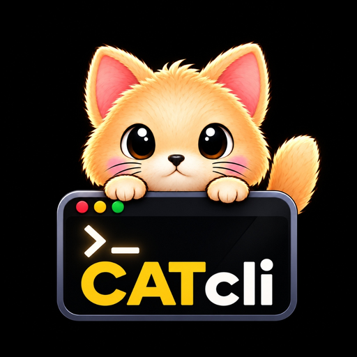

<div align="center">



# CAT — Coding Agent Terminal

**An AI-powered terminal-first coding environment that brings intelligent development, coding assistance, debugging, research, and planning directly into your development workflow.**

[](https://github.com/kazizillani-oss)
[](https://github.com/kazizillani-oss/CAT_v0.7.9)

<!-- Row 1: Marketplace & Versioning -->
[](https://marketplace.visualstudio.com/items?itemName=KaziZillani.cat-cli)
[](https://marketplace.visualstudio.com/items?itemName=KaziZillani.cat-cli)
[](https://marketplace.visualstudio.com/items?itemName=KaziZillani.cat-cli)
[](https://marketplace.visualstudio.com/items?itemName=KaziZillani.cat-cli)
[](https://pypi.org/project/cct-cli/)
[](https://github.com/kazizillani-oss/CAT_v0.7.9/blob/main/LICENSE)

<!-- Row 2: Project Health, Runtime & Platforms -->
[](https://github.com/kazizillani-oss/CAT_v0.7.9/actions/workflows/ci.yml)
[](https://github.com/kazizillani-oss/CAT_v0.7.9/stargazers)
[](https://github.com/kazizillani-oss/CAT_v0.7.9/network/members)
[](https://github.com/kazizillani-oss/CAT_v0.7.9/issues)
[](https://www.python.org/)
[](https://github.com/kazizillani-oss/CAT_v0.7.9)

<br/>

<!-- Animated Product Demonstration -->


</div>

---

## 💡 Why CAT?

**CAT (Coding Agent Terminal)** brings an autonomous, multi-agent AI pair programmer directly into your editor without Webview bloat, external window switching, or opaque background execution.

* **Dedicated Editor Tab in Editor Group 2**: CAT opens side-by-side with your code files in a dedicated native terminal editor tab (`CAT CLI v0.8.9.01`), filling the available editor space rather than cramming into a small bottom panel.
* **Terminal-First Workflow**: Full terminal transparency. You see every shell command, file change, diagnostic trace, and test run in real time.
* **Multi-Agent Coordination**: Autonomous task decomposition with specialized agents for Planning, Architecture, Implementation, Research, and Diagnostics.
* **Model Context Protocol (MCP)**: Native integration with MCP servers, external developer tools, and database APIs.
* **Resilient Multi-Provider Routing**: Seamless failover across local Ollama models (DeepSeek-R1, Llama 3, Qwen) and cloud APIs (Claude 3.7, GPT-4o, Gemini 2.0).

---

## ⚡ Core Features

| Feature | Description |
| :--- | :--- |
| **Native Editor Tab** | Launches directly into **VS Code Editor Group 2** (`ViewColumn.Two`) with custom CAT icon branding. |
| **Intelligent Lifecycle** | Single-click launch, automatic session reveal on repeat clicks, zero duplicate terminal clutter. |
| **Multi-Agent Runtime** | Coordinated agents that handle complex refactoring, test generation, and architectural analysis. |
| **Local & Cloud LLMs** | Full support for local offline Ollama models and cloud APIs (Anthropic, OpenAI, Google, DeepSeek). |
| **Backup Resilience** | Automatic rate-limit and network fallback to secondary models without losing session context. |
| **Workspace Intelligence** | Real-time file system cache, AST symbol indexing, and workspace-aware context injection. |
| **Command-Safety Boundary**| Clear distinction between safe read-only automation and protected state mutations. |
| **Auto Python Discovery** | Automatically locates venvs, conda environments, Poetry runtimes, and system Python interpreters. |

---

## 🤖 Available AI Modes & Specialized Agents

CAT features dedicated operating modes tailored for distinct phases of software engineering:

* 💻 **Coder Agent**: Focused on rapid implementation, bug fixing, test suite generation, and clean idiomatic refactoring.
* 📐 **Architect Agent**: High-level system design, modular breakdown, dependency planning, and scalability reviews.
* 🔬 **Researcher Agent**: Deep code exploration, documentation lookups, API specification research, and web inquiries.
* 🩺 **Debugger Agent**: Automated root cause analysis, stack trace diagnosis, terminal log inspection, and self-healing fixes.
* 🧪 **Compute & Science**: Chemical computation, formulas, equation derivations, and scientific simulations.

---

## 🔌 AI Provider Integration & Failover

CAT connects with your preferred AI models with zero vendor lock-in:

```text
┌─────────────────────────────────────────────────────────────┐
│                 CAT Intelligent Model Router                │
└──────────────────────────────┬──────────────────────────────┘
                               │
       ┌───────────────────────┼───────────────────────┐
       ▼                       ▼                       ▼
 🦙 Ollama (Local)      ⚡ Anthropic Claude      🧠 OpenAI & Gemini
 DeepSeek-R1 / Qwen     Claude 3.5 / 3.7 Sonnet    GPT-4o / Gemini 2.0
 (100% Private Offline)  (Complex Agentic Logic)   (Multi-Modal & Speed)
```

### Automatic Backup Failover
When a primary provider encounters rate limits (`429`), quota exhaustion, or network disconnects, CAT automatically transitions requests to your designated backup provider (e.g. falling back from Claude/GPT to local Ollama) ensuring your coding flow remains completely uninterrupted.

---

## 📦 Installation

### 1. Install the VS Code Extension

Install **CAT — Coding Agent Terminal** directly from the Visual Studio Code Marketplace:

* **Marketplace Link**: [CAT — Coding Agent Terminal](https://marketplace.visualstudio.com/items?itemName=KaziZillani.cat-cli)
* **VS Code Quick Open**: Press <kbd>Ctrl+P</kbd> (or <kbd>Cmd+P</kbd> on macOS) and run:
  ```bash
  ext install KaziZillani.cat-cli
  ```
* **Command Line**:
  ```bash
  code --install-extension KaziZillani.cat-cli
  ```

#### Cursor, Antigravity & Windsurf (Open VSX)
For VS Code forks that utilize Open VSX:
```bash
cursor --install-extension cat-cli-0.8.10.vsix
```

---

### 2. Install CAT CLI (GitHub Source Installation)

The extension acts as a native launcher bridge for the real Python-based CAT CLI runtime. Install CAT CLI locally via GitHub:

```bash
# 1. Clone CAT
git clone https://github.com/kazizillani-oss/CAT_v0.7.9.git

# 2. Enter the CAT directory
cd CAT_v0.7.9

# 3. Install CAT locally in editable mode
python -m pip install -e .

# 4. Verify installation
cat --version
```

> **Windows PowerShell Notice**: PowerShell includes a built-in alias `cat -> Get-Content`. If typing `cat` in PowerShell prompts for `Path[0]:`, launch CAT with `cat.exe` or `python -m calc_terminal`. The extension automatically handles this resolution.

---

## 🚀 Quick Start

1. Open your project folder in Visual Studio Code.
2. Click the **CAT Open** button in the editor title bar or press <kbd>Ctrl+Alt+C</kbd> (<kbd>Ctrl+Cmd+C</kbd> on macOS).
3. **Editor Group 2** will open side-by-side with your code files, presenting your active `CAT CLI v0.8.9.01` terminal tab.
4. Type your prompt, select an agent mode, or run `/help` to view all available commands.

---

## 🖥️ Dedicated Editor Group 2 Experience

Unlike conventional extensions that force terminal interactions into the lower panel, CAT CLI treats your AI terminal as a first-class editor document:

* **Side-by-Side Pair Programming**: Edit your source code in Editor Group 1 while CAT executes and monitors commands in Editor Group 2.
* **Full Height & Width**: Maximize terminal readability, complex diff inspections, and multi-column tables.
* **Lifecycle Awareness**:
  - **First Click**: Creates and focuses `CAT CLI v0.8.9.01` in Editor Group 2.
  - **Repeat Clicks**: Seamlessly reveals and focuses the existing session without creating duplicate tabs.
  - **Tab Closure**: Cleanly cleans up background bindings and prepares for a fresh session on the next invocation.

---

## ⌨️ Keyboard Shortcuts

| Shortcut | macOS | Action |
| :--- | :--- | :--- |
| <kbd>Ctrl + Alt + C</kbd> | <kbd>Ctrl + Cmd + C</kbd> | **CAT: Open** (Launches or reveals CAT in Editor Group 2) |

---

## 📋 Extension Commands

All commands are accessible via the Command Palette (<kbd>Ctrl+Shift+P</kbd> or <kbd>Cmd+Shift+P</kbd>):

| Command ID | Title | Description |
| :--- | :--- | :--- |
| `kazizillani.cat.open` | `CAT: Open` | Opens or reveals CAT CLI in Editor Group 2. |
| `kazizillani.cat.restart` | `CAT: Restart` | Closes and restarts the dedicated CAT CLI terminal session. |
| `kazizillani.cat.close` | `CAT: Close` | Closes the active CAT CLI terminal tab. |
| `kazizillani.cat.checkInstallation` | `CAT: Check Installation` | Verifies Python environment and CAT runtime installation. |

---

## ⚙️ Extension Settings

Configure CAT to match your workflow via **Settings** (<kbd>Ctrl+,</kbd> search for `cat`):

| Setting | Default | Description |
| :--- | :--- | :--- |
| `cat.executable` | `"cat"` | CAT launcher command or executable path. Supports `{workspace}` template variable. |
| `cat.launchArguments` | `[]` | Additional command-line flags or arguments passed to CAT at launch. |
| `cat.pythonPath` | `""` | Explicit Python interpreter path. Leave empty to enable auto-detection. |
| `cat.autoDetectPython` | `true` | Automatically discover `.venv`, conda, Poetry, and system Python environments. |
| `cat.reuseTerminal` | `true` | Reuse the existing Editor Group 2 terminal tab instead of opening duplicates. |
| `cat.autoStart` | `false` | Automatically launch CAT CLI when VS Code opens a workspace. |

---

## 🔒 Command-Safety & Automation Contract

CAT enforces a strict boundary between non-destructive automation and state mutations:

* **Read-Only Commands (Safe for unattended scripting & CI)**:
  - `cat --version` / `cat -v`: Reports installed CLI version.
  - `cat --debug`: Outputs deterministic runtime diagnostics and path verification.
  - `cat update --check`: Queries GitHub releases for updates without modifying files.
* **State-Changing Commands (Protected)**:
  - `cat update`, `cat rollback`, `cat repair`: Protected against unintended invocation in automated non-interactive sessions.

---

## 💻 System Requirements

* **Operating System**: Windows 10/11 (x64/arm64), macOS 12+ (Intel/Apple Silicon), or Linux (x64/arm64).
* **VS Code**: Version `^1.100.0` or higher.
* **Python**: Python `3.10`, `3.11`, `3.12`, or `3.13`.
* **Shell**: PowerShell, Bash, Zsh, or Fish.

---

## 🩺 Troubleshooting & Diagnostics

### 1. Python or CAT Not Detected
Run **CAT: Check Installation** from the Command Palette. If Python or CAT is not installed, click **Install CAT** to run the guided setup flow.

### 2. Windows PowerShell Alias Conflict
If running `cat` in PowerShell prompts for `Path[0]:`, PowerShell is invoking its built-in `Get-Content` alias. Launch with `cat.exe` or configure `"cat.executable": "cat.exe"` in settings.

### 3. SSL Certificate Issues on Fresh Python Installs
If `pip install` fails with `CERTIFICATE_VERIFY_FAILED`, update certificates:
```bash
python -m pip install --upgrade pip --trusted-host pypi.org --trusted-host files.pythonhosted.org
```

---

## ❓ Frequently Asked Questions (FAQ)

<details>
<summary><b>Does CAT run offline?</b></summary>
Yes! CAT provides full support for local LLMs via Ollama (e.g. DeepSeek-R1, Llama 3, Qwen). When using local models, zero code or prompt data leaves your machine.
</details>

<details>
<summary><b>Can I customize the terminal tab placement?</b></summary>
By default, CAT CLI opens in Editor Group 2 to provide optimal side-by-side pair programming with your files. You can drag and dock the editor tab into any editor group or layout configuration.
</details>

<details>
<summary><b>How does terminal reuse work?</b></summary>
When <code>cat.reuseTerminal</code> is enabled (default), clicking <b>CAT: Open</b> or pressing <kbd>Ctrl+Alt+C</kbd> focuses your existing session. If the session has exited, it cleanly starts a fresh one.
</details>

---

## 🗺️ Roadmap

- [x] Dedicated Editor Group 2 native terminal tabs.
- [x] Official CAT brand identity and high-resolution Marketplace iconography.
- [x] Theme-compatible light/dark SVG toolbar integration.
- [ ] Direct bi-directional diagnostics link with VS Code Problems pane.
- [ ] One-click diff staging and inline Git commit drafting from CAT terminal.
- [ ] Pre-packaged offline Ollama model bundle configuration wizard.

---

## 🤝 Contributing

Contributions, bug reports, and suggestions are welcome!

1. Fork the repository: [https://github.com/kazizillani-oss/CAT_v0.7.9](https://github.com/kazizillani-oss/CAT_v0.7.9)
2. Create your feature branch (`git checkout -b feature/amazing-feature`).
3. Commit your changes (`git commit -m 'Add amazing feature'`).
4. Push to the branch (`git push origin feature/amazing-feature`).
5. Open a Pull Request.

---

## 📄 License & Attribution

Distributed under the **MIT License**. See [`LICENSE`](https://github.com/kazizillani-oss/CAT_v0.7.9/blob/main/LICENSE) for more information.

Designed and developed with ❤️ by **[Kazi Zillani](https://github.com/kazizillani-oss)** and the open-source community.
